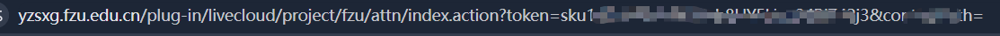
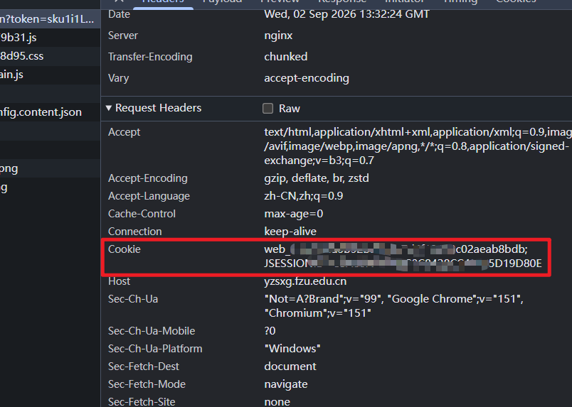

# Fxxk-fzusign — 晚点名签到一键运行器

对 **晚点名签到** 的**授权式自动提交客户端**:读取本地 `data.json` 里的会话与定位配置,在签到时间窗口内自动调用 `check.action`(范围校验)与 `clockIn.action`(提交签到)。模板默认只读预览。

> 脚本按 `data.json` 中填写的坐标与地址提交,**请填写你本人当时所在位置**。本工具不生成/伪造坐标、不绕过服务端校验、不替他人登录;它也无法证明“人确实在场”——真实性与合规性由使用者在填写时自行负责。

## 功能

- **一键签到**:顶层 `request.enabled=true` 后,`python main.py` 按 `users` 列表依次签到。
- **只读预览 / 会话探活**:`--dry-run` 只预览字段;`--check` 探活会话。
- **三重守卫**:① 服务端时间窗口;② 已成功/处理中不重复提交;③ 先跑 `check.action` 定位范围校验。
- **Cookie / token 自动刷新**(可选):有就直接用;缺失或失效时,用已有 Cookie 或账号密码走学校 SSO,把新值写回 `data.json`。
- **多用户汇总通知**:跑完向顶层 `WXKey` 推一条「全部成功 / 部分失败」,失败带原因。
- **网络重试**:超时 30 秒,网络错误最多 3 次。
- **运行日志**:写入 `logs/zhfd-YYYYMMDD.log`。

## 环境

需要 **Python 3.10+**。

```powershell
python -m pip install -r requirements.txt
copy data.json.example data.json
```

Linux / macOS 用 `cp data.json.example data.json`。`data.json` 已加入 `.gitignore`,不要提交到 Git。

## 配置

模板默认 `request.enabled=false`(只读预览)。先 `--dry-run` / `--check` 通过后,再把顶层 `enabled` 改成 `true`。

### 顶层共用

| 字段 | 填什么 |
| --- | --- |
| `request.enabled` | 总开关。`true` 才真正提交签到。 |
| `WXKey` | 汇总通知的 Server酱 SendKey。跑完推一条总结果。 |
| `timeout_seconds` | HTTP 超时,默认 `30`。 |
| `retry_times` | 网络错误重试次数,默认 `3`。 |
| `app` / `encryption` | 已按当前接口预填,正常不用改。 |

也可用 `python main.py --config 其他.json` 指定配置文件。

### 每个用户 `users[]`

| 字段 | 必填? | 填什么 |
| --- | --- | --- |
| `name` | 是 | 显示名,日志/通知用来区分用户。 |
| `enabled` | 否 | 该用户开关,默认 `true`;`false` 则跳过。 |
| `WXKey` | 否 | 与顶层不同时,该用户额外再推一条个人通知。 |
| `auth.token` | 优先 | 晚点名页面 URL 里 `token=…`。缺失/失效时可自动刷新。 |
| `auth.cookie` | 优先 | 会话 Cookie。有就直接用;缺失/失效时可自动刷新。 |
| `auth.username` / `auth.password` | 否 | 没有 Cookie 或 Cookie/token 失效时才用来自动登录。 |
| `location.longitude` / `latitude` / `address` | 签到时是 | 本人当时所在位置。 |

最低组合:已有 `cookie`+`token`,或只填账号密码(脚本登录后两者都会写回)。只填 Cookie 也可以,授权页能换到 token 时会自动补上。

### 凭证怎么取

1. 用本人账号登录 **https://yzsxg.fzu.edu.cn/**,进入晚点名签到页面。
2. 按 F12:

   - **token**:地址栏 / 请求 URL 里 `token=...`

     

   - **Cookie**:`Network` 面板里任一条 `yzsxg.fzu.edu.cn` 请求头 `Cookie:` 整串,类似 `web_route=...; JSESSIONID=...`

     

3. Cookie 和 token 都可以自动刷新:缺失或接口判定未登录时,脚本会打开授权页/SSO,从跳转 URL 取出 `token=`,和 Cookie 一起写回 `data.json`。
4. 学校 SSO 平时无验证码。若风控弹出验证码 / 短信二次验证,自动登录会失败,需浏览器手动登录后再把 Cookie/token 填回。

### 怎么取真实坐标

打开 [高德坐标拾取器](https://lbs.amap.com/tools/picker),点到**本人当时所在位置**。返回格式为 `经度,纬度`(如 `119.191596,26.05005`):

- `location.longitude` 填经度,`location.latitude` 填纬度,别填反。
- `location.address` 填对应文字地址,例如 `福州大学旗山校区博学苑X区XXXXX`。

### 微信通知

在 [Server酱 Turbo](https://sct.ftqq.com/) 申请 SendKey,填顶层 `WXKey`。`--dry-run` 不推汇总。多用户结束时例如:

```
全部签到成功
张三成功
李四成功

部分失败
张三成功
李四失败，原因：cookie错误
```

常见失败原因:`cookie错误` / `登录失败` / `token错误` / `不在签到窗口` / `定位不在校区` / `网络超时` / `配置缺项`。

## 使用

| 命令 | 做什么 |
| --- | --- |
| `python main.py --dry-run` | 只读预览将发送的字段,不签到、不推汇总。 |
| `python main.py --check` | 探活 init / 时间戳。Cookie/token 缺失或失效时自动刷新。 |
| `python main.py --refresh-cookie` | 强制刷新 Cookie/token 并写回。有 Cookie 或账号密码即可,不签到。 |
| `python main.py` | 顶层 `request.enabled=true` 时一键签到。 |
| `python main.py --user 张三` | 只跑名为「张三」的用户。 |
| `python main.py --config 其他.json` | 指定配置文件。 |

签到窗口由服务端返回(常见 `21:30–23:59`)。窗口外运行会停止发送。

### 定时任务示例

把工作目录换成你的仓库路径。建议窗口开始后几分钟再跑,例如 `21:35`。

Windows 计划任务(每天 21:35):

在「任务计划程序」里新建基本任务:触发器选每天 21:35,操作选启动程序,程序填 `python`,参数填 `main.py`,起始于填仓库目录。

Linux crontab:

```cron
35 21 * * * cd /path/to/zhfd && python3 main.py >> logs/cron.log 2>&1
```

## 运行测试

```powershell
python -m unittest utils.analysis.test_main_protocol_runner -v
```

## 代码结构

```
main.py                    编排 + CLI
data.json.example          配置模板(复制为 data.json)
logs/                      按日运行日志(不提交)
utils/
  config.py                配置加载/校验、用户展开、Cookie/token 回写
  net.py                   HTTP、重试、头插值
  sso.py                   学校 SSO 登录，刷新 Cookie/token
  log.py                   按日写入 logs/
  notification.py          Server酱个人/汇总通知
  crypto.py / protocol.py / payload.py / schedule.py
```
